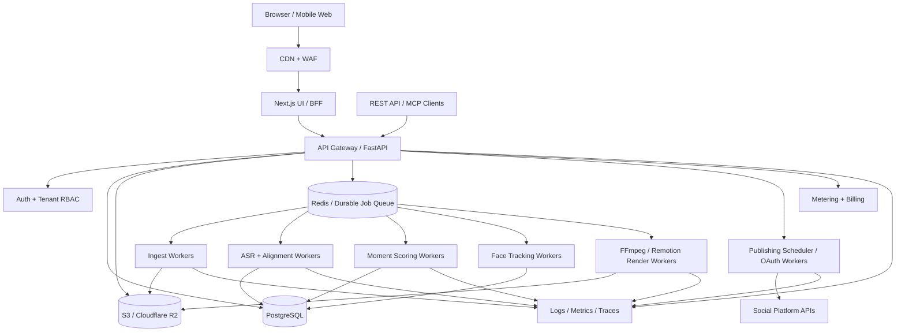
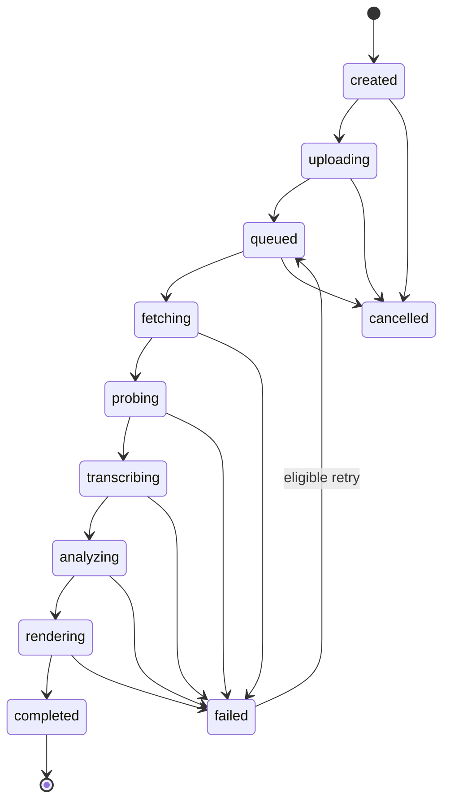
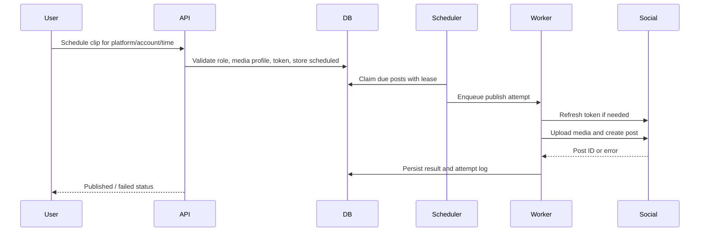

# ScaleReach-like AI Video Repurposing Platform — Technical Architecture & Implementation Blueprint

**Version:** 1.0  
**Research date:** 2026-11-17  
**Purpose:** Engineering specification for building an independently implemented long-form-to-short-form video SaaS.  
**Important:** ScaleReach's actual source code, cloud topology, models, databases and internal algorithms are not public. Sections marked **Observed** describe public documentation; sections marked **Proposed** are an original, implementable reference architecture, **not** claims about ScaleReach's internal systems.

## 1. Executive summary

Build a multi-tenant platform that accepts uploaded video or authorized video URLs, transcribes audio with word timestamps, discovers semantically complete short-form moments, ranks them, creates crops and animated captions, renders clips, allows nondestructive editing, and publishes through approved social platform APIs. Provide workspace isolation, metering, API keys, agent/MCP integrations, audit logs and resilient background processing.

### 1.1 Evidence and confidence

| Area | Public evidence | Confidence |
|---|---|---|
| Four processing stages: fetch, transcribe, find moments, render | ScaleReach help guide | Observed |
| Server-side workers continue after browser closes | Processing guide | Observed |
| Transcript-driven clip ranking, emotion labels | Review clips guide | Observed |
| Timeline editing, AI face reframe | Editor guide | Observed |
| Workspace-scoped billing, brand kits, social accounts, members | Workspace guide | Observed |
| OAuth social scheduling and failed-post retries | Publishing guide | Observed |
| API submit, status poll, list clips | Developer docs | Observed |
| Exact model, database, queue, infrastructure provider | Not publicly established | Unknown |
| PostgreSQL, Redis, FFmpeg, WhisperX, workers | This document's recommendation | Proposed |

## 2. Scope and feature specification

### 2.1 Ingestion
- Browser file upload; multipart upload with resumability, checksum and size validation.
- URL import adapters for YouTube and permitted providers (Twitch, Kick, Drive, Dropbox, Loom, Rumble, Dailymotion, Wistia, Vidyard, Streamable and direct file URLs). **Provider support is an advertised ScaleReach capability, not proof of a particular ingestion technique.**
- Require user authorization and respect platform terms, licensing, access permissions and rate limits. Prefer official APIs, user-owned uploads and signed provider downloads; do not circumvent DRM or access controls.
- Extract duration, dimensions, frame rate, rotation, codec, audio streams and language hints via ffprobe.
- Deduplicate imports within the same tenant using source fingerprint; never expose another tenant's file.
- Accept `mp4`, `mov`, `webm`; add `mkv`/`avi` only after codec testing.

### 2.2 Transcription
- Extract normalized mono 16-kHz audio for ASR, preserving source-to-audio timestamp mapping.
- Detect language; transcribe in chunks with overlap; merge and remove duplicates.
- Align words to precise timestamps; assign speaker turns if diarization is enabled.
- Store immutable source transcript and editable revisions; preserve punctuation and confidence.
- Optional translation, subtitle export (`srt`, `vtt`) and per-word caption timing.

### 2.3 Clip discovery and scoring
- Segment by speech pauses, sentence boundaries, topic changes and optional scene cuts.
- Generate candidate windows (e.g. 15–90 seconds; configurable) aligned to complete thoughts.
- Rank for hook, coherence, payoff, novelty, emotion, pacing and audience relevance.
- Deduplicate overlapping candidates with temporal IoU and semantic similarity.
- Return explanations and detected topics/emotions; scores are editorial heuristics, **not validated forecasts of views**.
- Support user-provided goals, target platform, clip count, preferred length and banned topics.

### 2.4 Video transformation
- Render 9:16, 1:1 and 16:9 with safe zones and platform profiles.
- Detect and track faces/subjects; calculate smooth time-varying crop; fallback to center crop, blurred background or letterboxing.
- Support speaker-aware split-screen, square-frame layout and optional user-supplied gameplay/background media.
- Burn animated word-level captions with brand fonts/colors, highlights, outline, shadow and placement.
- Add hooks, logos, text, images, music where licensed, thumbnails and watermarks per plan.
- Produce downloadable MP4 (H.264/AAC baseline), poster, preview and metadata.

### 2.5 Editing and collaboration
- Nondestructive JSON edit decision list (EDL) and versioned project state.
- Trim, caption corrections, reframe, aspect ratio, overlays, caption style, background, audio mix, thumbnail.
- Preview using lightweight proxies; final render through authoritative server pipeline.
- Clip library, favorites, filters (score, aspect ratio, emotion), batch export, public unlisted share links.
- Workspace brand kit, members, roles, comments and approval states (collaboration can be phased).

### 2.6 Publishing
- Official OAuth account connection and encrypted token storage.
- Schedule one clip to multiple destinations with platform-specific copy and settings.
- Calendar with draft/scheduled/publishing/published/failed/cancelled states.
- Idempotent publish workers, token refresh, retry/backoff and reconciliation against provider post IDs.
- Support direct media upload for scheduling independently of AI generation.
- Treat each platform's media rules, permissions and app-review requirements as changeable.

### 2.7 Developer platform
- Workspace-scoped API keys with hashed-at-rest secrets, one-time display, prefix, last-used, scopes, rotation and revocation.
- REST endpoints, webhooks (proposed), usage reporting and job polling.
- MCP tools for workspace listing, video submission, job status, clip listing, clip detail and scheduling; tool actions must enforce workspace permissions and minute budgets.

## 3. Reference system architecture (Proposed)



**Why these boundaries:** API servers remain stateless; large media never flows through the app server when direct upload is possible; jobs are durable; GPU workers scale separately from CPU render workers; social publishing is isolated from video generation.

### 3.1 Deployment topology
- `web`: CDN-hosted Next.js application.
- `api`: stateless FastAPI instances behind ingress, JWT validation, request limits.
- `postgres`: managed PostgreSQL with PITR backups.
- `redis`: caching, distributed locks and optionally job broker; use a durable queue with acknowledged delivery and dead-letter handling for critical jobs.
- `object`: private R2/S3 buckets with short-lived signed upload/download URLs.
- `workers-ingest`: CPU/network optimized; egress controls and anti-SSRF checks.
- `workers-asr`: GPU-enabled, autoscaled; optional external ASR vendor fallback.
- `workers-ai`: CPU or inference API for LLM ranking.
- `workers-cv`: GPU or CPU face detection/tracking.
- `workers-render`: CPU/GPU FFmpeg/Remotion, concurrency and memory limits.
- `workers-publish`: low-concurrency OAuth and external API jobs.
- `scheduler`: distributed leader or database-backed due-post poller.
- `observability`: OpenTelemetry traces, Prometheus-compatible metrics, centralized logs, alerting.

## 4. End-to-end processing workflow

### 4.1 User journey
1. User creates workspace; chooses plan and brand kit.
2. User uploads a file or pastes an authorized source URL.
3. API validates workspace quota, MIME/URL and source permissions; reserves estimated processing minutes.
4. Client uploads to private object storage via short-lived presigned URL or ingestion worker fetches source.
5. Media probe extracts metadata and creates a proxy/thumbnail.
6. Audio extraction and ASR produce sentence/word timestamps.
7. Candidate segmentation and LLM scoring produce scored moments.
8. Deduplication selects a diverse top-N set.
9. CV tracking computes crop keyframes for each candidate.
10. Renderer generates previews, thumbnails and full-quality clips.
11. User reviews, edits and rerenders without re-running ASR when unnecessary.
12. User downloads, shares, or schedules a post.
13. Publish worker posts, records provider ID, reconciles status and surfaces failures.

### 4.2 Video processing state machine



Use separate per-stage status records and a user-friendly aggregate status. A stage can be retried without rerunning completed immutable outputs. Every stage writes an artifact manifest and completion marker atomically.

### 4.3 Job contract

```json
{
  "job_id": "job_uuid",
  "workspace_id": "ws_uuid",
  "video_id": "video_uuid",
  "stage": "transcribing",
  "attempt": 1,
  "idempotency_key": "ws:video:transcribe:v1",
  "input_manifest_uri": "s3://private-bucket/.../manifest.json",
  "pipeline_version": "2026-11-v1",
  "trace_id": "trace_uuid"
}
```

Use an outbox table for transactional event publication. Workers must be idempotent: retries check the output manifest before consuming more paid compute.

## 5. AI clip selection — detailed design

### 5.1 Segmentation
1. Split transcript into sentence spans, each with start/end times.
2. Group adjacent spans by topic similarity, speaker continuity and silence gaps.
3. Generate windows meeting configured minimum and maximum length.
4. Expand boundaries to avoid mid-word or mid-thought starts/ends.
5. Filter empty speech, copyrighted/disallowed content if required by policy, low-quality audio and near-duplicates.

### 5.2 Structured LLM scoring
Provide each candidate's timed transcript, brief surrounding context and target audience. Ask for strictly validated JSON, not free-form edits to timestamps. Example output:

```json
{
  "candidate_id": "cand_123",
  "start_ms": 152000,
  "end_ms": 196000,
  "topic": "How to price a service",
  "hook": "Most freelancers undercharge for this reason",
  "scores": {
    "hook": 0.88,
    "coherence": 0.91,
    "payoff": 0.84,
    "pacing": 0.72,
    "novelty": 0.69
  },
  "emotions": ["curiosity", "surprise"],
  "rationale": "Clear opening claim followed by a concrete example",
  "needs_context": false
}
```

### 5.3 Scoring formula (illustrative, not ScaleReach's proprietary formula)

`score = 100 * (0.30*hook + 0.25*coherence + 0.20*payoff + 0.15*pacing + 0.10*novelty)`

Apply penalties for clipped sentences, incomplete payoff, silence, repetition and unsafe/irrelevant content. Calibrate against human ratings and retention data where permission exists. Do **not** label this score as a statistical probability of going viral without validation.

### 5.4 Candidate diversification
- Sort by score; select candidates subject to max overlap and topic diversity.
- Use temporal IoU threshold (e.g. 0.35) and embedding cosine similarity threshold (e.g. 0.90), tuned with real evaluation data.
- Preserve rejected candidates in DB for editor recovery and experiments.
- Allow human override and manual clip creation.

### 5.5 Evaluation
- Human preference win rate, usable-clip precision@K, boundary quality, average review time, edit rate, semantic diversity.
- Do not optimize only for high scores; compare against baseline random windows and silence-based windows.
- Keep offline evaluation sets separated by creator/source to avoid leakage.

## 6. Transcription and caption engine

### 6.1 Pipeline
`source -> ffmpeg audio -> VAD -> ASR -> forced alignment -> punctuation -> optional diarization -> transcript words -> caption grouping -> animation render`

- Store timestamps in integer milliseconds, not floats, to avoid drift.
- Caption groups: 2–5 words or a short phrase; configurable by style.
- Highlight active word by frame-time comparison with word spans.
- Support per-language font fallback, bidirectional text and emoji rendering.
- Use safe-zone positioning to avoid platform controls.
- Edits to transcript text must preserve or recompute timing carefully; inserted words without speech need explicit timing semantics.

### 6.2 Sample word schema

```json
{"id":"w_01","start_ms":1240,"end_ms":1620,"text":"Build","speaker_id":"spk_1","confidence":0.97}
```

### 6.3 Caption rendering choices
- **FFmpeg drawtext/libass:** inexpensive, deterministic; advanced animation requires filters or pre-rendered alpha overlays.
- **Remotion:** React composition and reusable animated caption components; higher render overhead.
- **Hybrid:** browser preview in React, export via Remotion/FFmpeg with a shared composition schema.
- Keep a canonical timeline JSON independent of renderer to avoid preview/export divergence.

## 7. AI reframing and crop tracking

1. Sample frames at adaptive intervals (e.g. 2–5 FPS for tracking; increase near cuts).
2. Detect faces/persons; assign persistent track IDs across frames.
3. Estimate active speaker where diarization/lip-motion support is available; otherwise choose dominant subject.
4. Compute crop center for target aspect ratio, respecting face margins and overlay safe zones.
5. Smooth crop center with interpolation / low-pass filtering; constrain speed and acceleration.
6. Handle scene cuts by resetting track continuity.
7. Fallback to center crop, letterbox or background blur when no reliable subject exists.
8. Persist crop keyframes; allow manual editor override.

**Failure modes:** two speakers, slides/screen shares, rapid camera motion, occlusion, tiny faces, gaming footage. Offer split-screen or square-frame modes instead of forcing face crop.

## 8. Nondestructive editing data model

```json
{
  "project_version": 3,
  "source_video_id": "video_uuid",
  "trim": {"start_ms": 152000, "end_ms": 196000},
  "canvas": {"width": 1080, "height": 1920, "fps": 30},
  "crop": {"mode": "tracked", "keyframes": [{"t_ms": 0, "cx": 0.50, "cy": 0.45, "scale": 1.0}]},
  "captions": {"transcript_revision_id": "rev_2", "style_id": "bold-yellow", "y": 0.78},
  "layers": [{"type":"text","start_ms":0,"end_ms":3000,"text":"WATCH THIS","x":0.5,"y":0.12}],
  "audio": {"source_gain_db": 0, "music_asset_id": null},
  "render_profile": "shorts_1080p"
}
```

Editor actions mutate a versioned project document; server validates it against a schema. Use optimistic concurrency via `version` or `ETag`. Renders point to the exact immutable project version used.

## 9. Database design (Proposed)

### 9.1 Core tables
| Table | Key columns / relationships |
|---|---|
| users | id, email, auth_subject, created_at |
| workspaces | id, slug, owner_user_id, plan_id, status |
| workspace_members | workspace_id, user_id, role, invited_at |
| brand_kits | workspace_id, fonts_json, colors_json, logo_asset_id |
| assets | id, workspace_id, object_key, kind, size, checksum, mime |
| videos | id, workspace_id, source_type, source_url, asset_id, duration_ms, state |
| processing_jobs | id, video_id, stage, status, attempt, error_code, started_at |
| transcripts | id, video_id, language, revision, text, model_version |
| transcript_words | transcript_id, index, start_ms, end_ms, text, speaker_id |
| clip_candidates | id, video_id, start_ms, end_ms, score_json, rationale |
| clips | id, workspace_id, video_id, candidate_id, favorite, status |
| clip_projects | id, clip_id, version, edl_json, updated_by |
| renders | id, clip_id, project_version, profile, asset_id, status |
| thumbnails | id, clip_id, asset_id, selection_method |
| share_links | id, clip_id, token_hash, expires_at, revoked_at |
| social_accounts | id, workspace_id, provider, external_id, token_secret_ref |
| scheduled_posts | id, clip_id, social_account_id, scheduled_at, status, caption |
| publishing_attempts | id, scheduled_post_id, attempt, provider_post_id, error_code |
| api_keys | id, workspace_id, prefix, secret_hash, scopes, last_used_at, revoked_at |
| subscriptions | workspace_id, provider, provider_subscription_id, status |
| usage_ledger | id, workspace_id, video_id, kind, minutes, idempotency_key |
| audit_events | id, workspace_id, actor_id, action, resource_id, timestamp |
| outbox_events | id, aggregate_id, event_type, payload, published_at |

### 9.2 Isolation
Every tenant-owned table has `workspace_id` directly or through a validated parent. Enforce workspace ownership in every query, object-storage path, queue message and signed URL. Use PostgreSQL row-level security if feasible, but still enforce application authorization. Unique constraints: `(workspace_id, slug)`, `(workspace_id, idempotency_key)` for metering, `(clip_id, version)` for projects.

### 9.3 Retention
- Raw video retention per plan; disclose deletion schedule.
- Clip deletion may leave original source available; deletion semantics must be explicit.
- Support account export/deletion, signed URL expiry and audit retention policy.

## 10. REST API design

**Observed public API examples:** `POST /api/videos/youtube`, `GET /api/videos/{id}/status`, `GET /api/videos/{id}/clips`, `GET /api/videos/{id}`. These are documented ScaleReach endpoints; the following expanded API is **proposed for your implementation**.

| Method | Proposed endpoint | Purpose |
|---|---|---|
| POST | `/v1/uploads/init` | Create presigned multipart upload |
| POST | `/v1/uploads/complete` | Validate upload and enqueue |
| POST | `/v1/videos/import` | Import permitted URL |
| GET | `/v1/videos/{id}` | Metadata and status |
| GET | `/v1/videos/{id}/jobs` | Stage-level progress |
| GET | `/v1/videos/{id}/transcript` | Transcript and words |
| PATCH | `/v1/videos/{id}/transcript` | Create transcript revision |
| GET | `/v1/videos/{id}/candidates` | Ranked moments |
| POST | `/v1/videos/{id}/clips` | Create manual or candidate clip |
| GET | `/v1/clips` | Library and filters |
| GET | `/v1/clips/{id}` | Clip detail |
| PATCH | `/v1/clips/{id}/project` | Versioned edit operations |
| POST | `/v1/clips/{id}/renders` | Queue render |
| GET | `/v1/renders/{id}` | Render status and signed output |
| POST | `/v1/clips/{id}/share-links` | Create unlisted link |
| POST | `/v1/social/connect/{provider}` | Begin OAuth |
| POST | `/v1/posts` | Schedule publishing |
| GET | `/v1/posts` | Calendar and status |
| POST | `/v1/posts/{id}/retry` | Retry failed publish |
| GET | `/v1/usage` | Minute balance and ledger |
| POST | `/v1/api-keys` | Create workspace key |
| DELETE | `/v1/api-keys/{id}` | Revoke key |

### 10.1 Sample import request

```http
POST /v1/videos/import
Authorization: Bearer <token>
Idempotency-Key: <uuid>
Content-Type: application/json

{"workspace_id":"ws_uuid","source":{"type":"youtube","url":"https://www.youtube.com/watch?v=..."},"config":{"aspect_ratios":["9:16"],"captions":true,"clip_count":12,"language":"auto"}}
```

Return `202 Accepted` with `video_id`, `job_id`, `status_url`. Use RFC 7807-style error objects with stable codes, not raw stack traces. Implement cursor pagination, per-tenant rate limits, signed webhook payloads and retry-safe POST requests.

## 11. Publishing subsystem



- Use DB leases/unique dispatch keys to avoid duplicate posts.
- Retries on 429/5xx with jitter; do not retry permanent validation errors without user action.
- Provider APIs may be non-idempotent: reconcile by provider identifiers before replaying ambiguous attempts.
- Encrypt OAuth refresh tokens via KMS; scope narrowly; log no secrets.
- Handle timezone and DST by storing UTC schedule plus user timezone.

## 12. Usage, quotas and billing

### 12.1 Metering policy
- Define chargeable unit: source-video minutes, e.g. rounded up per source or measured to seconds and aggregated. Publish exact policy.
- Reserve quota before expensive work; finalize after processing; release reservation on qualifying failures.
- Regenerating a clip may incur render compute without retranscription; decide whether to charge separately and explain clearly.
- Keep append-only ledger with idempotency key to prevent duplicate charges on job retries.
- Apply workspace limits to uploads, source length, social accounts, members, concurrent jobs and retention.

### 12.2 Cost model

`cost_per_video = ingest_egress + ASR_GPU_seconds*GPU_rate + LLM_tokens*token_rate + CV_seconds*rate + render_seconds*rate + storage_GB_months*rate + outbound_GB*rate`

`gross_margin = (recognized_revenue - variable_inference_render_storage_delivery_cost) / recognized_revenue`

Example **hypothetical** 60-minute input (not a measured benchmark): ASR 4 minutes GPU, analysis 40k input + 4k output tokens, CV 3 minutes, 12 clips × 45 seconds rendered. Actual runtime varies greatly by hardware and source complexity. Benchmark before setting pricing.

### 12.3 Operational controls
- Per-workspace concurrency and daily spend ceilings.
- GPU queue priorities by plan; backpressure when overloaded.
- Cache ASR and candidate analysis by immutable source hash + model/config version.
- Render only selected clips initially if GPU/CPU costs are high; offer previews first.

## 13. Security and privacy threat model

| Threat | Mitigation |
|---|---|
| Cross-tenant data leakage | Workspace authorization, RLS, tenant-scoped object keys and tests |
| SSRF from URL import | Provider allowlist, DNS/IP validation after redirects, deny private/metadata IPs, egress proxy |
| Malicious media | MIME sniffing, size/time limits, isolated FFmpeg sandbox, patched codecs, no privileged containers |
| API key leak | Hashed secrets, one-time display, scopes, rotation, rate limits, last-used audit |
| OAuth token theft | KMS encryption, minimum scopes, secure callback state/PKCE |
| Public share-link guessing | Cryptographically random tokens, hash at rest, revocation, optional expiry |
| Prompt injection in transcripts | Treat media text as untrusted data; constrain LLM to structured output; no tool privileges |
| Excessive inference spending | Quota reservation, hard budgets, job cancellation and timeout |
| Duplicate billing or posting | Idempotency keys, transactional outbox, provider reconciliation |
| Copyright and consent issues | User attestation, takedown process, platform-compliant imports and licensed assets |

Include malware scanning, CSP, CSRF defenses for cookie sessions, dependency scanning, backups, access logs and data-subject deletion workflows.

## 14. Reliability and observability

### 14.1 SLO suggestions (targets, not observed metrics)
- API availability: 99.9% monthly.
- Job acceptance latency: p95 under 1 second excluding upload.
- Worker queue wait: track by plan and stage; set threshold after load tests.
- Render success rate: >99% for supported codec fixture set.
- Publish result accounting: 100% of attempts reach terminal or explicitly retryable state.

### 14.2 Metrics
`videos_submitted_total`, `job_stage_duration_seconds`, `job_failures_total{stage,error}`, `queue_oldest_age_seconds`, `asr_realtime_factor`, `clips_per_video`, `clip_acceptance_rate`, `render_seconds_per_output_minute`, `gpu_utilization`, `minutes_reserved`, `minutes_consumed`, `publish_attempts_total{provider,status}`, `storage_bytes_by_workspace`.

### 14.3 Failure recovery
- Poison messages to dead-letter queue with diagnostics.
- Resume from stage artifact manifests; never restart full pipeline unnecessarily.
- Cancellation propagates to workers and releases unused quota.
- Reconcile abandoned running jobs using leases and heartbeat expiration.
- Restore drills for DB and object storage; periodically test disaster recovery.

## 15. Quality assurance and test plan

### 15.1 Media fixtures
- Short/long inputs, variable frame rate, rotated phone video, silent video, multiple audio tracks, mono/stereo, low bitrate, high FPS, 4K, corrupt files, non-English, subtitles, screen shares, two speakers and fast cuts.

### 15.2 Tests
- Unit: timestamp math, candidate overlap, score normalization, billing idempotency, auth scope.
- Integration: upload → ASR → candidates → render, mocked social APIs, signed URLs.
- Visual regression: caption timing, crop safe zones, overlays, fonts and emoji.
- Load: concurrent uploads, GPU queue depth, object-store egress, render throughput.
- Security: tenant boundary, SSRF redirects, expired tokens, public link isolation.
- End-to-end: account → workspace → import → clip review → edit → download → scheduled post.

### 15.3 Acceptance criteria for MVP
1. A permitted 30-minute source can be uploaded/imported and processed asynchronously.
2. Word-aligned transcript is viewable and editable.
3. At least five candidate clips can be reviewed, with explanations and editable boundaries.
4. Selected clips render 9:16 with readable captions and downloadable MP4.
5. Jobs survive client disconnects; failures can be retried without duplicate charges.
6. Workspace A cannot read workspace B's data via any API or object URL.
7. Usage balance is correct across retries and concurrent jobs.

## 16. Build roadmap and dependencies

| Phase | Deliverables | Dependencies | Exit gate |
|---|---|---|---|
| 0: Foundation | Auth, workspace, DB, R2/S3, upload, queue, FFmpeg probe | Cloud account, CI/CD | Upload and retrieve private video |
| 1: AI pipeline | ASR, word alignment, candidates, ranking, clip render | GPU/ASR provider, LLM, caption renderer | Long video produces useful clips |
| 2: Editor | Timeline, trims, crop, caption styles, JSON EDL, rerender | Phase 1 artifact contracts | Preview matches final render |
| 3: Library | Filters, favorites, share links, batch export, brand kits | Stable clip schema | Users can manage 100+ clips |
| 4: Publishing | OAuth, scheduler, status, retries, calendar | Platform approvals | Real test account publishes safely |
| 5: Platform | Metering, subscriptions, API keys, webhooks, MCP, teams | Tenant isolation, audit logs | API clients work with scoped keys |
| 6: Scale | Autoscaling, budgets, benchmarks, retention, monitoring | Real usage telemetry | SLOs and margin targets met |

### 16.1 Suggested team split
- Frontend: dashboard, clip library, timeline editor, player, scheduling UI.
- Backend: tenancy, API, usage, auth, integrations, publishing.
- ML/media: ASR, clip discovery, face tracking, render pipeline.
- DevOps/QA: deployment, queues, observability, codec test matrix and security.

### 16.2 MVP simplifications
- Start with file uploads + permitted YouTube URLs only.
- Use a hosted ASR model before self-hosting GPUs if volume is low.
- Start with transcript-only scoring; add visual scoring after measuring error cases.
- Render 9:16 only, with 3 caption styles and one safe fallback crop.
- Let users download before investing in platform-specific publishing approvals.

## 17. Suggested repository layout

```text
platform/
  apps/
    web/                 # Next.js dashboard/editor
    api/                 # FastAPI HTTP + auth + tenancy
    mcp-server/          # Optional agent interface
  services/
    ingest-worker/
    asr-worker/
    analysis-worker/
    vision-worker/
    render-worker/
    publish-worker/
    scheduler/
  packages/
    contracts/           # OpenAPI, JSON schema, events
    timeline-schema/     # EDL schema + validation
    caption-styles/      # Shared style definitions
    media-utils/         # ffprobe / ffmpeg wrappers
  infra/
    terraform/
    docker/
    observability/
  tests/
    fixtures/
    integration/
    e2e/
  docs/
    adr/
    runbooks/
```

## 18. Engineering decisions to resolve before coding

1. Hosted ASR versus self-hosted faster-whisper, by measured cost and language quality.
2. Remotion-only versus FFmpeg-only versus hybrid rendering; benchmark 10 real clips.
3. Queue: Celery + Redis/RabbitMQ, BullMQ or cloud-native durable queue; pick based on language and delivery guarantees.
4. What counts toward quota, especially retries, source duplicates and rerenders.
5. Whether to prioritize AI discovery quality or rapid processing latency.
6. Which social platform(s) can be approved for publishing at launch.
7. Tenant model: one subscription per workspace versus per user.
8. How to handle deleted source videos with existing clips and share links.
9. Which language markets require diarization, translation and font support.
10. Consent, content rights, privacy policy, moderation and retention.

## 19. ScaleReach public API observations

Official docs specify base URL `https://api.scalereach.ai`, workspace API keys and a documented sequence:

```text
POST /api/videos/youtube
GET  /api/videos/:id/status
GET  /api/videos/:id/clips
GET  /api/videos/:id
```

The published status example progresses `downloading → transcribing → analyzing → completed`; the help centre describes rendering as a separate stage. This difference may reflect UI/API abstraction and should not be interpreted as an internal contradiction without testing. The official documentation also describes signed clip download URLs. **Do not assume undocumented response fields or replicate the competitor's exact API names as your public contract.**

## 20. Sources and research links

Public pages accessed/retrieved 2026-11-17:

1. ScaleReach homepage — https://www.scalereach.ai/
2. Help centre — https://www.scalereach.ai/help/
3. Processing stages — https://www.scalereach.ai/help/what-happens-during-processing/
4. Clip editing — https://www.scalereach.ai/help/edit-a-clip/
5. Clip review/scoring — https://www.scalereach.ai/help/review-the-clips-from-a-video/
6. Library and sharing — https://www.scalereach.ai/help/find-clips-in-your-library/
7. Workspace model — https://www.scalereach.ai/help/create-a-workspace/
8. Publishing — https://www.scalereach.ai/help/schedule-clips-to-social/
9. API keys — https://www.scalereach.ai/help/api-keys/
10. Developer API introduction — https://docs.scalereach.ai/docs
11. Get video API — https://docs.scalereach.ai/docs/videos/get-video
12. Pricing and plan limits — https://www.scalereach.ai/pricing/

**Research limitation:** No authenticated access, network traces, private code, deployment configuration or real processing benchmarks were available. All infrastructure diagrams, formulas, schemas and implementation choices above are original proposals for an independently built product.
